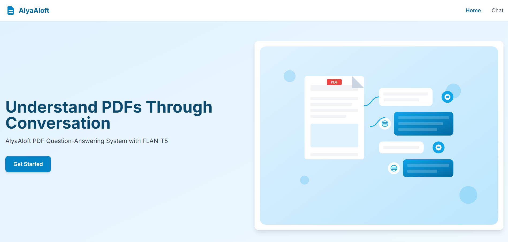

# AlyaAloft: Advanced Document Q&A



## Overview
AlyaAloft is a retrieval-augmented document question-answering system. It answers questions about uploaded PDFs with a locally run FLAN-T5 model, using semantic retrieval and query-aware prompting to get good answers from a small, CPU-friendly language model.

## Key Features

- **Advanced Prompting Techniques**: Domain-specific templates, chain-of-thought reasoning, and iterative refinement for complex questions
- **Optimized Model Performance**: 8-bit quantization for CUDA-enabled devices to reduce memory usage while maintaining quality
- **PDF Document Processing**: Extract and chunk document content for efficient retrieval
- **Conversation Memory**: Maintain context across multiple user queries
- **Responsive Web Interface**: Clean, modern UI for document upload and querying

## How It Works

1. **Text extraction:** PDF text is read with `pypdf`; scanned pages can fall back to Tesseract OCR if it is installed.
2. **Chunking and structure:** the text is split into overlapping chunks (NLTK sentence tokenisation), and document sections are detected.
3. **Retrieval:** chunks are embedded with `all-MiniLM-L6-v2` (Sentence-Transformers) and the most relevant ones are selected by cosine similarity.
4. **Prompting:** the query is classified (definition, explanation, comparison, summary…) and a matching prompt template is built from the retrieved context.
5. **Generation:** FLAN-T5 generates the answer, with iterative refinement for complex questions and an optional self-verification pass.
6. **Memory:** conversation state is kept per document so follow-up questions have context.

## Screenshots


## Demo & Documentation

- 📄 [Project Documentation](https://drive.google.com/file/d/1ugB9d5J-ESTpnnsBfedatvcySZByb_Qw/view)
- 🎥 [Video Preview](https://drive.google.com/file/d/1yh6PwrA9BkQT_A1Vz3L7Cna-tNLyN0TO/view)

## Getting Started

### Prerequisites

- Python 3.8+ with pip
- PyTorch with CUDA support (recommended for faster inference)
- 4GB+ RAM (8GB+ recommended)
- 2GB+ free disk space for models

### Installation

1. **Clone the repository**:
   ```bash
   git clone https://github.com/Prathameshv07/AlyaAloft.git
   cd AlyaAloft
   ```

2. **Create a virtual environment in python or conda**:
   ```bash
   # create a python virtual environment
   python -m venv venv
   source venv/bin/activate  # On Windows: venv\Scripts\activate

   # create a conda virtual environment
   conda create -n venv python=3.9
   conda activate venv
   ```

3. **Install dependencies**:
   ```bash
   pip install -r requirements.txt
   ```

4. **Download the FLAN-T5 model** (saved to `models/`):
   ```bash
   python scripts/download_t5_model.py
   ```
   
   For a smaller model (better for limited resources):
   ```bash
   python scripts/download_t5_model.py --model google/flan-t5-small
   ```
   
   For better quality (requires more RAM):
   ```bash
   python scripts/download_t5_model.py --model google/flan-t5-large
   ```

### Running the Application

Start the application with:

```bash
python start_app.py
```

By default, the server will run on http://127.0.0.1:8000.

Command-line options:
```bash
python start_app.py --host 0.0.0.0 --port 9000 --log-level DEBUG
```

### Performance Tuning

- AlyaAloft uses CUDA automatically when available (run with `--log-level DEBUG` to confirm). On CUDA, `pip install bitsandbytes` enables 8-bit quantization.
- For slow machines or low memory, use `flan-t5-small`, or lower `max_length` / `num_beams` in `T5_CONFIG` and `max_context_chunks` in `PIPELINE_CONFIG` (`app/config/model_config.py`).
- Uploaded documents, embeddings, chat history, logs and models are stored locally in `data/`, `conversations/`, `logs/` and `models/`. These folders are created at runtime and are git-ignored.

## Usage

1. **Open the web interface** in your browser at http://127.0.0.1:8000/chat
2. **Upload a PDF document** using the upload button
3. **Ask questions** about the document in natural language
4. **View responses** with reference to the source document

## Project Structure

```
AlyaAloft/
├── app/
│   ├── main.py                  # FastAPI application
│   ├── app_config.py            # Paths, upload limits, embedding settings
│   ├── config/model_config.py   # FLAN-T5 generation settings and prompt templates
│   ├── prompts/                 # Query-type detection and document prompts
│   ├── routes/                  # REST API (upload, documents, chat) and web pages
│   ├── storage/                 # JSON-file storage with file locking
│   ├── utils/
│   │   ├── pdf_processor.py     # Extraction, chunking, embeddings, retrieval
│   │   ├── document_structure.py
│   │   ├── document_chunking.py
│   │   ├── model_orchestrator.py # Model loading, prompting, refinement
│   │   ├── prompt_manager.py
│   │   └── state_manager.py     # Conversation memory
│   ├── static/, templates/      # Web UI
├── scripts/download_t5_model.py # Model downloader
├── tests/                       # pytest suite
├── start_app.py                 # CLI entry point
├── requirements.txt
├── CITATION.cff
└── LICENSE
```

## Tests

```bash
python -m pytest tests
```

## Citation

If you use or build on this project, please cite it. GitHub's **"Cite this repository"** button (generated from [`CITATION.cff`](CITATION.cff)) provides APA and BibTeX formats.

```bibtex
@software{vaidya_alyaaloft_2025,
  author = {Vaidya, Prathamesh Sarjerao},
  title  = {AlyaAloft: Retrieval-Augmented Document Question Answering with FLAN-T5},
  year   = {2025},
  url    = {https://github.com/Prathameshv07/AlyaAloft}
}
```

## License

[](https://creativecommons.org/licenses/by-nc/4.0/)

© 2025 Prathamesh Sarjerao Vaidya. This work is licensed under the [Creative Commons Attribution-NonCommercial 4.0 International License](https://creativecommons.org/licenses/by-nc/4.0/). You may share and adapt it for **non-commercial** purposes, provided you **give appropriate credit** and indicate any changes. See [LICENSE](LICENSE) for details.
